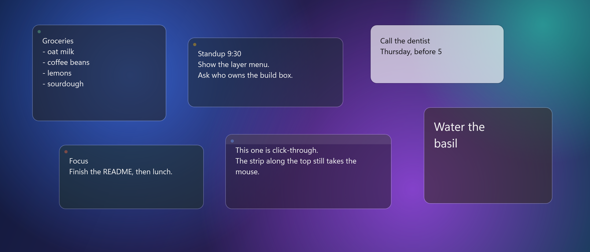
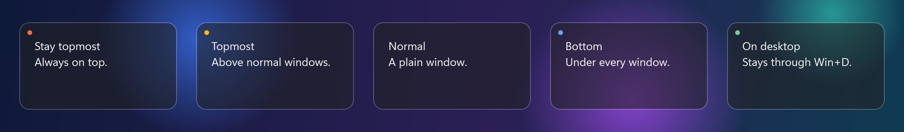

# DeskNotes

[](LICENSE)
[](https://github.com/LeahyCC/desk-notes/releases/latest)
[](https://github.com/LeahyCC/desk-notes/actions/workflows/ci.yml)

Sticky notes for Windows 11 that sit on the desktop the way Rainmeter skins do. Each note picks its own layer, from always on top down to the desktop itself, and the glass lets the wallpaper show through.



## Download

Get the exe from the [latest release](https://github.com/LeahyCC/desk-notes/releases/latest). There are two:

- `DeskNotes-<version>-win-x64.exe` runs on its own. About 69 MB.
- `DeskNotes-<version>-win-x64-needs-dotnet10.exe` is about 600 KB but needs the [.NET 10 Desktop Runtime](https://dotnet.microsoft.com/download/dotnet/10.0).

There is no installer. Put the exe somewhere it can stay and run it. The exe isn't signed, so Windows SmartScreen warns the first time: click More info, then Run anyway.

## Getting started

DeskNotes has no window of its own. It lives in the tray by the clock, and Windows may hide the icon behind the `^` arrow. With no notes saved yet, it opens a welcome note.

- Double-click the tray icon for a new note.
- Right-click the tray icon to make a note, show or hide all of them, start with Windows, open the notes folder, or quit.
- Turn on "Start with Windows" after the exe is where you want it. The tick remembers that path, and turns off if you move the exe.
- Ctrl+Alt+N makes a new note at the mouse. Ctrl+Alt+H shows or hides every note. If another program already uses one of those, the tray menu still has the action.

Only one copy runs at a time. Starting the exe again shows your notes.

## Using notes

- Right-click a note for its layer, colour, glass, text size, lock position, click-through, new note and delete.
- Drag a note by the padding around the text. There is no title bar.
- Resize from any edge.
- Ctrl+mouse wheel changes the text size.
- There are six tints: Dark, Slate, Moss, Plum, Clay and Light.
- Glass sets how see-through a note is at rest: Clear, Glass, Frosted or Solid. A note you are typing in goes almost solid.
- Lock position stops a note being dragged or resized.
- Delete moves the note to a trash folder. DeskNotes never deletes a file outright.

Click-through lets the mouse fall through a note to whatever is under it. A faint strip across the top stays live: right-click it to turn click-through off again, or drag it to move the note.

## Layers



```
Stay topmost   always above everything, re-asserted every second
Topmost        above normal windows
Normal         ordinary window
Bottom         under every window, above the wallpaper
On desktop     Bottom, and stays visible when Win+D shows the desktop
```

The dot in the top-left corner shows the layer: orange stay topmost, amber topmost, blue bottom, green on desktop. No dot means normal. The dot brightens when the mouse is over the note.

## Files

Notes are plain markdown in `%APPDATA%\DeskNotes\notes\`, one file per note, with position and look in a frontmatter block. Deleted notes move to `%APPDATA%\DeskNotes\trash\`. Frontmatter lines DeskNotes does not use (Obsidian tags, say) are kept when it saves.

```
---
x: 1850
y: 900
w: 260
h: 200
color: #202020
font: 14
z: OnDesktop
clickthrough: true
locked: true
opacity: 55
---
Note text here.
```

You can edit these by hand while DeskNotes is closed. A value it can't read falls back to the default. Notes saved on a monitor that is no longer there come back on the main one when DeskNotes starts, stepped apart so they do not sit in one pile.

If DeskNotes crashes, or a note file cannot be read, it writes what happened to `%APPDATA%\DeskNotes\error.log`. The other notes still open.

## How the layers work

`ZOrder.cs` has the detail. The short version:

- Bottom hooks `WM_WINDOWPOSCHANGING` and rewrites every raise request to `HWND_BOTTOM`.
- On desktop is Bottom plus a watcher. A hidden marker window sits at the bottom of the stack. When Show Desktop lifts the desktop window above the marker, the notes go topmost until it drops back.
- Re-parenting into the desktop window (what wallpaper engines do) was tried first. On Windows 11 24H2 and later nothing parented there renders, so it was dropped.
- Notes swallow `SC_MINIMIZE` and `SC_CLOSE`, so Win+M and Alt+F4 do not take them away.
- Click-through sets `WS_EX_TRANSPARENT`. A 40ms timer clears it while the cursor is over the top strip, because a transparent window gets no mouse messages at all.

## Build from source

Needs Windows 11 and the [.NET 10 SDK](https://dotnet.microsoft.com/download/dotnet/10.0).

```
dotnet run
```

Publish a single exe:

```
dotnet publish -c Release -r win-x64 --self-contained false -p:PublishSingleFile=true
```

The exe lands in `bin\Release\net10.0-windows\win-x64\publish\`.

## Status

Early days. Not yet checked by hand: behaviour on a second monitor. The app is system DPI aware, so on a monitor scaled differently from the main one Windows stretches the notes and the text looks soft.

## Contributing

Issues and pull requests are welcome. [CONTRIBUTING.md](CONTRIBUTING.md) covers building, checking a change by hand and how pull requests are merged. Everyone taking part follows the [Code of Conduct](CODE_OF_CONDUCT.md). Report security problems privately, as [SECURITY.md](SECURITY.md) explains, not in a public issue.

## License

MIT. See [LICENSE](LICENSE).
